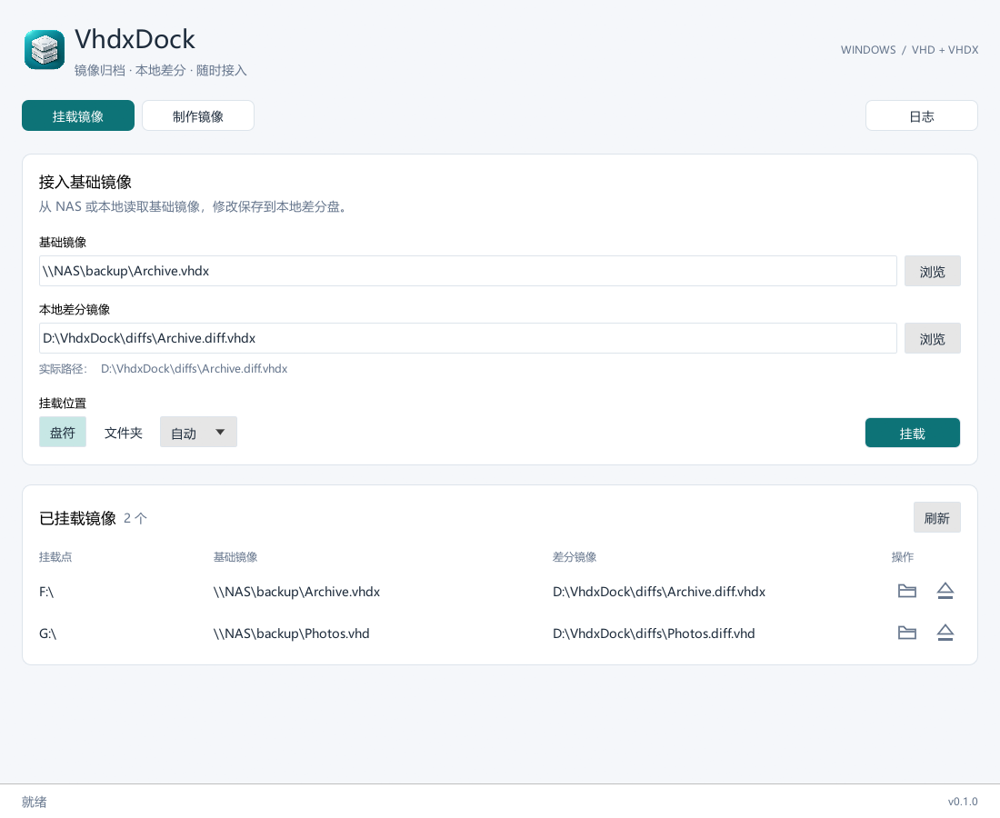
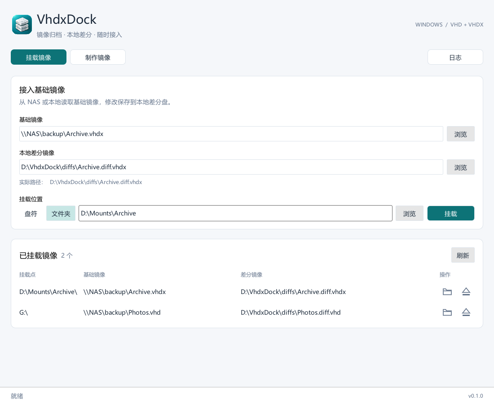
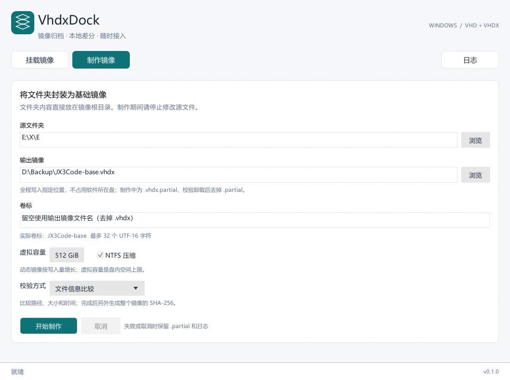
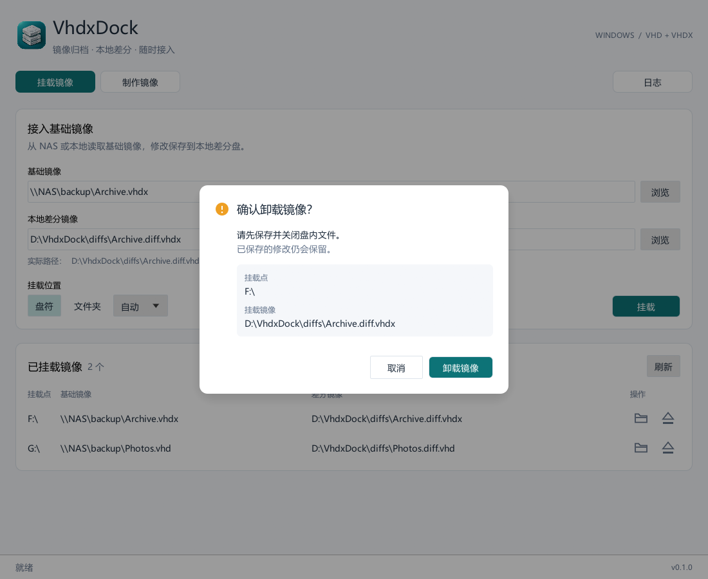
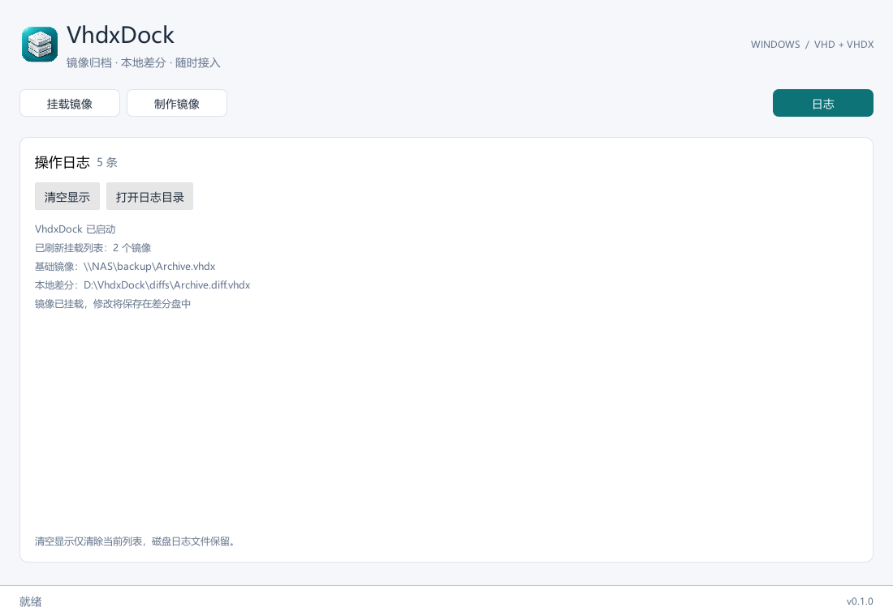

# VhdxDock

Windows 便携式 VHDX 镜像制作与 VHD/VHDX 差分挂载工具。

将文件夹封装为单个基础镜像；基础镜像可以保存在 NAS，本地差分盘承接所有修改。挂载后作为普通 Windows 磁盘使用，卸载、重新挂载后修改仍然保留。

> 开发预览版本。自动化测试只使用临时小镜像；实际 NAS 的 SMB、权限、断线行为需要在你的环境验证。请保留原数据，完成备份校验后再决定是否清理。

## 界面预览

以下截图使用当前界面重新渲染，全部来自独立的演示数据，不读取本机配置或真实挂载记录。文件名、文件夹、NAS 地址和日志内容均为虚构示例。

**盘符挂载与多磁盘管理**：挂载点、基础镜像、差分镜像、操作四列随内容和窗口宽度自动分配空间，每行提供打开和卸载图标。



**文件夹挂载**：切换到“文件夹”后，在同一行填写或浏览挂载目录，再点击挂载。



**制作镜像**：选择源目录、输出路径和卷标，设置虚拟容量、压缩与校验方式。



**卸载二次确认**：挂载点与镜像路径单独展示，取消和卸载按钮靠右排列；默认聚焦取消，直接按回车不会卸载。



**日志页签**：与挂载、制作页签同排，位于最右侧，可查看本次会话的操作记录。



可点击操作悬停时显示手形指针；截断路径悬停时仅显示一个完整路径提示。

## 功能

- **挂载**：基础镜像、本地差分两条路径；差分不存在自动创建，存在则验证父链后复用。基础镜像搬迁后，直接填写新地址挂载即可。
- **挂载位置**：可使用自动或指定盘符，也可挂载到本地 NTFS 卷上的空文件夹；文件夹模式不分配盘符。
- **防止自动优化膨胀差分盘**：挂载时自动将虚拟卷排除出 Windows 计划优化；按卷 GUID 识别，适用于盘符和文件夹挂载，重复挂载会补设保护。保留其他卷的优化计划和已有排除项。
- **格式**：挂载 VHD / VHDX，新制作统一输出动态 VHDX。
- **多磁盘管理**：已挂载列表按挂载点、基础镜像、差分镜像、操作四列展示，列宽随内容和窗口自动调整，截断路径悬停可查看完整内容。每行提供打开和弹出图标；弹出必须二次确认，繁忙卷拒绝卸载。
- **制作**：源目录内容直接放进镜像根目录，包括隐藏文件、`.git`、空目录，链接按链接保留。
- **卷标**：制作时可自定义 Windows 磁盘名称，直接写入基础镜像；留空则使用输出镜像文件名（不含 `.vhdx`）。
- **压缩**：GPT + NTFS，默认开启镜像内部 NTFS 压缩。
- **校验**：默认文件信息比较，可选逐文件 SHA-256；完成后额外生成整个镜像的 `.sha256` 文件。
- **后台任务**：制作、扫描、校验和磁盘操作不会阻塞界面，支持取消制作、查看日志和记忆配置。
- **日志**：与“挂载镜像”“制作镜像”同排、靠右的“日志”页签，切换查看操作记录。

## 获取与运行

在 [Releases](https://github.com/tinymins/vhdxdock/releases) 下载 Windows x64 预览版，或在 [Actions](https://github.com/tinymins/vhdxdock/actions) 的成功构建中下载 `VhdxDock-windows-x64`。解压到本地可写目录，运行 `VhdxDock.exe`。

- Windows 10 / 11 x64；依赖系统内置 PowerShell 5.1、Storage 模块和 Robocopy。
- 启动时请求管理员权限。取消授权后退出。
- 无需第三方镜像驱动或 Hyper-V PowerShell 模块。
- 中文字体从 Windows 字体目录读取，不附带第三方商业字体。

## 挂载 NAS 镜像

1. 基础镜像填 `\\NAS\backup\Archive.vhdx`，推荐使用 UNC 地址而不是映射盘符。
2. 差分默认 `.\diffs\Archive.diff.vhdx`，也可选择如 `D:\Diff\Archive.diff.vhdx`。切换基础镜像时保留当前差分目录，只将文件名更新为新基础镜像名加 `.diff.vhd` 或 `.diff.vhdx`。启动时保留已保存的完整地址；挂载时自动创建缺失的目录。
3. 在“挂载位置”选择 **盘符** 或 **文件夹**。盘符支持自动分配；文件夹模式选择已有的本地 NTFS 空目录，例如 `D:\Mounts\Archive`，再点击 **挂载**。
4. 在下方列表点击文件夹图标打开磁盘，点击弹出图标并确认后卸载。

挂载成功前，工具检查并更新 Windows `ScheduledDefrag` 任务的卷选择参数，再读取确认。碎片整理会搬动已有文件，用户没有新增文件也可能让差分盘大幅增长。排除的是镜像内的虚拟卷，承载镜像或挂载文件夹的宿主盘仍按原计划优化。卸载后保留卷排除，避免换位置或再次挂载时失去保护。

无法读取、更新或确认计划优化设置时，本次新挂载会报错并尝试安全卸载；已挂载镜像补设失败时明确提示先弹出。优化任务正在运行或包含无法安全处理的自定义参数时也会拒绝报告挂载成功。此保护针对 Windows 计划优化，不阻止手动或第三方工具执行整理，也不会缩小已经膨胀的差分文件。

所有相对路径固定相对于 **exe 所在目录**；界面显示实际绝对路径。例如软件位于 `D:\VhdxDock\VhdxDock.exe`，默认差分文件就是 `D:\VhdxDock\diffs\Archive.diff.vhdx`。差分必须放本地，大小会随修改增加。如果 exe 在 C 盘而希望写入 D 盘，请修改差分路径。

差分仅保存变化，**不能脱离基础镜像使用**。卸载不会丢弃修改；关闭工具窗口也不会卸载已挂载磁盘。基础镜像在被差分依赖后必须保持原样，不要直接写入、合并、替换或重建。NAS 权限和 Windows 凭据由系统管理，本工具不保存密码。

文件夹只是访问入口，文件数据仍写入差分镜像所在磁盘。挂载目录必须事先创建并保持为空，不能是网络共享、盘根目录、符号链接或目录联接。文件夹模式要求镜像中只有一个可挂载的数据分区，避免挂载目标不明确。若镜像已经挂载，需要先卸载才能切换挂载位置。

卸载文件夹挂载同样需要二次确认；成功后移除挂载关系并保留原来的空目录。目录不会作为普通文件夹递归删除，差分盘中的修改会在下次挂载时继续保留。

## 制作文件夹镜像

填写源文件夹和一个输出镜像路径，设置卷标，选择虚拟容量（默认 512 GiB）、压缩和校验方式，然后开始制作。卷标就是资源管理器中盘符前的名称，可输入中文；留空则取输出文件名去掉 `.vhdx`，例如 `Archive.vhdx` 默认显示 `Archive`。名称最多 32 个 UTF-16 字符，过长时需手动填写较短卷标。它在格式化新基础镜像时写入，由之后创建的差分盘继承，挂载操作不会覆盖该名称。

制作期间请停止修改源目录；一期不提供 VSS 在线快照。

例如源 `D:\Data\Archive`，输出 `D:\Images\Archive.vhdx`：

```text
D:\Data\Archive\Documents  → 镜像根目录\Documents
D:\Data\Archive\Photos     → 镜像根目录\Photos

制作中：D:\Images\Archive.vhdx.partial
完成后：D:\Images\Archive.vhdx
校验值：D:\Images\Archive.vhdx.sha256
```

镜像数据全程写在选定输出目录，**不会缓存到 C 盘**，完成改名也不复制第二份镜像。NAS 输出采用相同流程，直接写到 NAS。

虚拟容量是挂载后磁盘的容量上限，动态镜像按实际写入量增长；内部压缩率取决于文件内容。工具会按未压缩数据加文件系统预留检查空间，不把预期压缩率当作空间保证。

默认校验比较文件信息，**不是逐字节内容校验**。重要归档可以选逐文件 SHA-256。符号链接和目录联接保存链接本身，外部目标数据不会被归档。文件内容、属性和时间戳会复制；不复制源所有者、ACL 和审计权限。

已有最终镜像、`.partial` 或同名校验文件时停止，不自动覆盖。失败或取消会保留未完成文件与日志，并尝试卸载本次制作的镜像；格式化等不可中断阶段会先结束，再取消清理。一期不支持断点续制。

可在管理员 PowerShell 检查镜像文件哈希：

```powershell
Get-FileHash -LiteralPath 'D:\Images\Archive.vhdx' -Algorithm SHA256
```

## 移动基础镜像

基础镜像搬迁前先弹出相关挂载。搬迁后在挂载页的“基础镜像”框填写新地址，“本地差分”框仍选择原来的差分文件，点击 **挂载** 即可。工具先验证镜像身份，确认仍是原基础镜像后，自动更新差分文件中的父路径并挂载，原有差分修改继续保留，无需额外操作入口。

工具拒绝身份、容量或逻辑扇区不匹配的基础镜像，不会忽略 Windows 父链校验。基础镜像仍必须保持不可变；路径更新不能用来适配已修改的基础镜像。已挂载的差分盘需要先弹出，再更新基础镜像地址。

相同文件名不代表相同父镜像。搬迁副本建议先核对完整 SHA-256；工具不会每次挂载读取几十 GB 计算哈希。VHDX 父链由 Windows 在打开时进一步验证。

## 配置与日志

优先保存到 exe 目录的 `config.json` 和 `logs/`；目录不可写时使用用户应用数据目录。制作日志包含扫描结果、链接、复制、复查和最终校验信息。不会在日志中保存 NAS 密码。

点击顶部最右侧的 **日志** 页签查看本次会话记录，可以清空显示或打开日志目录。清空显示不会删除磁盘上的日志文件；切换页签不影响正在进行的后台任务。

## 从源码构建

安装 Rust stable（最低 1.90）和 Visual Studio C++ Build Tools（MSVC、Windows SDK）：

```powershell
git clone https://github.com/tinymins/vhdxdock.git
cd vhdxdock
powershell -NoProfile -ExecutionPolicy Bypass -File .\scripts\build-windows.ps1 -Release
```

输出 `dist\VhdxDock.exe`。如果源码位于 WSL UNC 路径，给 Cargo 指定本地构建目录，避免 UNC 文件锁限制：

```powershell
powershell -NoProfile -ExecutionPolicy Bypass -File .\scripts\build-windows.ps1 -Release -TargetDir D:\Build\VhdxDock
```

验证：

```powershell
cargo fmt --all -- --check
cargo clippy --locked --all-targets -- -D warnings
cargo test --locked --all-targets
```

普通测试模拟计划任务，不修改本机优化设置。真实磁盘集成测试默认忽略，仅在管理员会话、显式设置测试开关后运行；磁盘写入只针对专用临时目录中的测试镜像，挂载还会把临时虚拟卷 GUID 加入本机计划优化排除列表，卸载后保留：

```powershell
$env:VHDXDOCK_RUN_DISK_TESTS = '1'
cargo test --locked --test windows_disks --test windows_builder -- --ignored --test-threads=1
```

## 技术与范围

Rust + egui/eframe；原生 VirtDisk API 管理镜像；Storage PowerShell 管理新虚拟磁盘分区；Robocopy 复制文件。

一期不支持 ISO、QCOW2、VMDK、SquashFS、镜像转换、合并回父盘、差分重置或开机自动挂载。

## License

MIT
